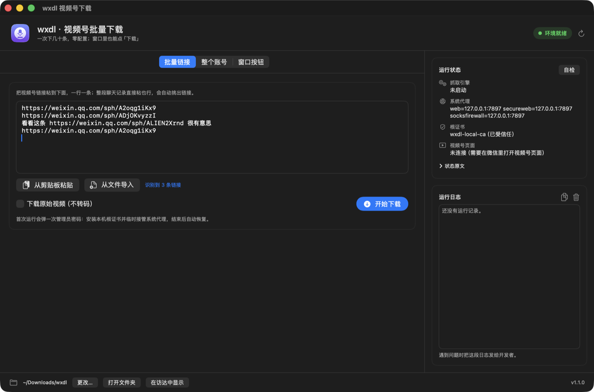

# wxdl

[](https://github.com/fuxm0818/wxdl/actions/workflows/ci.yml)
[](https://github.com/fuxm0818/wxdl/releases)
[](#支持范围)
[](LICENSE)

微信视频号短视频**批量**下载（macOS），两种用法：

- **桌面 App（推荐）**：下载 DMG，把 `wxdl.app` 拖进「应用程序」，双击打开——
  粘贴链接、点按钮，有任务列表、实时日志和运行状态。常驻模式也在里面（「窗口按钮」标签）。
- **命令行**：`wxdl get <链接...>` 一条命令批量下完，适合脚本和定时任务；App 里跑的就是它。



不用打开网页、不用一个个点下载按钮、不用懂抓包：环境自检、下载引擎、根证书、系统代理、
任务创建、进度显示、收尾恢复，App 和命令行都是全自动完成。

命令行则是这样：

```bash
wxdl get "https://weixin.qq.com/sph/A2oqg1iKx9" "https://weixin.qq.com/sph/ADjOKvyzzI"
```

```
待下载 2 个视频。
共 2 个视频，开始批量下载（下载目录：~/Downloads/wxdl）
[1/2] https://weixin.qq.com/sph/A2oqg1iKx9
下载 16% (4.7MB/28.8MB) ... 下载 85% (24.5MB/28.8MB)
  已保存：~/Downloads/wxdl/老王的线下派对 #人生价值 #经商之道 #白酒 #年轻人 #国潮_xWT111.mp4 (28.8 MB) 时长 2:58
[2/2] https://weixin.qq.com/sph/ADjOKvyzzI
  已保存：~/Downloads/wxdl/述职大会，我坚持要开下去 ..._xWT111.mp4 (9.3 MB) 时长 1:29
完成：2 成功，0 失败。
文件都在这里：~/Downloads/wxdl
已恢复系统代理设置，抓取引擎已停止。
```

> ⚠️ **仅供学习与技术研究。** 视频号内容有版权，请只下载你有权保存的视频，不要用于批量采集、
> 二次分发或任何商业用途。wxdl 是 MIT 许可，但它随附的抓取引擎是 MIT + "Commons Clause"
> （禁止出售），所以 **wxdl 及含 wxdl 的服务一律不得出售**。详见 [LICENSE](LICENSE)、
> [LICENSE-upstream](LICENSE-upstream)、[NOTICE-upstream.md](NOTICE-upstream.md)。

---

## 目录

- [它解决什么](#它解决什么)
- [支持范围](#支持范围)
- [安装](#安装)
- [桌面 App 怎么用](#桌面-app-怎么用)
- [第一次使用（5 分钟）](#第一次使用5-分钟)
- [使用示例](#使用示例)
- [参数一览](#参数一览)
- [子命令一览](#子命令一览)
- [运行时会发生什么](#运行时会发生什么)
- [常见问题](#常见问题)
- [工作原理](#工作原理)
- [技术栈与架构](#技术栈与架构)
- [和上游、res-downloader 是什么关系](#和上游res-downloader-是什么关系)
- [隐私与数据安全](#隐私与数据安全)
- [开发与发布](#开发与发布)
- [许可](#许可)

## 它解决什么

上游开源引擎 [`ltaoo/wx_channels_download`](https://github.com/ltaoo/wx_channels_download)
的 Release 版是「给视频号播放窗口加一个下载按钮」，**只能一条一条点**。wxdl 用它同一套解密能力，
**上游有的功能这里都有**（窗口里的「下载」按钮、原始视频），还补上了它没有的批量与零配置：

| 你想要的 | wxdl 的用法 |
| --- | --- |
| 完全不想碰终端 | 装 `wxdl.app`：粘贴链接 → 点「开始下载」，进度、日志、状态都在窗口里 |
| 一次下几十条链接 | App 里整段粘贴；命令行 `wxdl get <链接1> <链接2> ...` 或 `wxdl get --file links.txt` |
| 微信里复制了链接，懒得打字 | App 里点「从剪贴板粘贴」；命令行直接 `wxdl`（自动读剪贴板） |
| 某个账号最近的视频全下 | App「整个账号」标签；命令行 `wxdl user "账号昵称" --limit 50` |
| 同事完全不用命令行 | 把 App 给他，三步点完 |
| 想像上游一样，在视频号窗口里点「下载」按钮 | App 的「窗口按钮」标签点「开启下载按钮」；命令行 `wxdl on`，用完 `wxdl off` |
| 下原始视频，而不是转码版 | App 里勾「下载原始视频」；命令行 `wxdl get <链接> --spec original` |
| 中途 Ctrl-C / 断电不能坏网络 | 自动恢复系统代理，也可 `wxdl undo` 手动救 |
| 换一台 Mac 接着用 | Release 包里已内置引擎，首装不必访问 GitHub |

## 支持范围

**目前只支持 macOS，Intel 与 Apple Silicon 都有包。**

- 桌面 App：要求 **macOS 12 Monterey 及以上**（本轮在 macOS 26 + Apple Silicon 上实测；
  Intel 包在本机经 Rosetta 启动验证过，但真实 Intel Mac 上尚未跑通完整下载流程）。
- 命令行：要求 **macOS 11 Big Sur 及以上**；更低版本 `wxdl doctor` 只给警告，不保证可用。

> macOS 26 起，系统会提示「Intel 芯片 App 的支持即将结束」。这是 Apple 在逐步淘汰 Rosetta：
> Apple Silicon 用户请下载 `arm64` 包；`x86_64` 包只给真正的 Intel Mac 用。

原因很直白：微信视频号的视频是加密的，解密 key 只出现在本机微信与腾讯服务器的接口响应里，
所以工具必须临时接管**系统代理**并让系统**信任一个本机根证书**。这两件事在每个系统上的做法完全不同
（macOS 用 `networksetup` + `security add-trusted-cert`），而 wxdl 把这条链路做成「一次授权、自动恢复」
的只有 macOS 版本。代码能在 Linux/Windows 上编译通过，但代理与证书那一步必然失败，
所以**发布产物只有 darwin_arm64 与 darwin_x86_64 两个包**，不放"能装但跑不通"的平台包。

> **Windows 版呢？** 上游引擎本身有 Windows 构建（它还会用注册表设 WinINet 代理、`certutil` 装它自带的 CA），
> 但 wxdl 接管代理、装我们**自己生成**的根证书、提权与自动恢复这几层目前只有 macOS 实现。
> 没有在真实 Windows + 微信 + 视频号上跑通之前不会发 windows 包——同样按上面这条规矩。

另外还需要：

- 本机装有 **微信 Mac 版并已登录**（视频号页面必须能在微信里打开）。
- 你有这台电脑的**管理员密码**（安装脚本本身不用密码；第一次下载时要信任根证书、改系统代理，
  那一步绕不过去）。
- 如果你的 Clash / Surge 等代理软件在跑，**请先完全退出它们**（会抢系统代理）。
  桌面 App 与 `--yes` 模式不会替你退出，只会明确报错，避免误关你的软件。

**输入**：视频号分享链接（`https://weixin.qq.com/sph/…`、`https://channels.weixin.qq.com/…`）、
混在整段文字里的链接、`txt` 文件、标准输入、剪贴板；账号昵称 / username / 该账号任意一条视频链接。

**输出**：`mp4`，默认落到 `~/Downloads/wxdl/<视频标题>_<规格>.mp4`；已完成的任务直接复用文件
（App 里显示「跳过」）；加 `--json` 时 stdout 额外输出 NDJSON 事件流，供脚本和 App 消费。

## 安装

### 方式 A：桌面 App（推荐，下载 DMG）

1. 打开 <https://github.com/fuxm0818/wxdl/releases>，下载对应机型的 DMG：

   | 你的机器 | 文件 |
   | --- | --- |
   | Apple Silicon（M1/M2/M3/M4） | `wxdl_v1.2.1_darwin_arm64.dmg` |
   | Intel | `wxdl_v1.2.1_darwin_x86_64.dmg` |

   文件名里的版本号以 Release 页面实际列出的最新一版为准。

   不确定机型就点屏幕左上角的苹果菜单 → 「关于本机」：显示「芯片」并写着 M1/M2/M3/M4 的是
   Apple Silicon，显示「处理器」的是 Intel。

2. 双击 DMG，把 `wxdl.app` 拖到旁边的「应用程序」文件夹。

3. 第一次打开：在「应用程序」里 **右键 `wxdl.app` → 「打开」→ 再点一次「打开」**。
   wxdl 目前没有 Apple 开发者签名（签名 + 公证要付费的开发者账号），所以系统会拦一次；
   绕过这一次后就不再拦。也可以在终端执行：

   ```bash
   xattr -dr com.apple.quarantine /Applications/wxdl.app
   ```

4. 打开就能用，操作见 [桌面 App 怎么用](#桌面-app-怎么用)。App 里已经带了命令行 `wxdl`
   （`wxdl.app/Contents/Resources/bin/wxdl`），不需要再单独安装；想把它放进 `PATH`、或者只用终端，
   继续看方式 B。

### 方式 B：命令行包（tar.gz，不需要装 Go）

1. 同样在 <https://github.com/fuxm0818/wxdl/releases> 下载压缩包：

   | 你的机器 | 文件 |
   | --- | --- |
   | Apple Silicon（M1/M2/M3/M4） | `wxdl_v1.2.1_darwin_arm64.tar.gz` |
   | Intel | `wxdl_v1.2.1_darwin_x86_64.tar.gz` |

2. 双击压缩包解压，打开「终端」App，进去解压出来的目录并跑安装脚本：

   ```bash
   cd ~/Downloads/wxdl_v1.2.1_darwin_arm64
   sh install.sh
   ```

   `install.sh` 全程**不需要管理员密码**，它会：
   - 先清掉 macOS 给浏览器下载文件加的隔离属性——不清的话直接运行 `wxdl` 会被
     Gatekeeper 拦下，报「Apple 无法验证"wxdl"是否包含恶意软件」；
   - 用包内 `checksums.txt` 逐个校验 sha256，文件被改动过就直接拒绝安装；
   - 把 `wxdl` 装到 `~/.wxdl/bin/wxdl`，并把内置的抓取引擎包放进 `~/.wxdl/vendor/`；
   - 问你一句「要不要把 `~/.wxdl/bin` 加进 PATH」（写进 `~/.zshrc`，只加两行，随时可删；
     不想要就回答 n 或加 `--no-path`，之后用全路径 `~/.wxdl/bin/wxdl` 一样能用）；
   - 在桌面创建双击入口「批量下载视频号视频.command」。

   想让 `wxdl` 出现在 `/usr/local/bin`（需要输一次密码）就用 `sh install.sh --link`；
   这是可选项，不加软链完全不影响使用。

3. 自检一下环境，确认没问题再下载：

   ```bash
   wxdl doctor
   ```

   如果你**没跑 install.sh** 就直接运行了 `./bin/wxdl`，被 macOS 拦下是正常的：
   要么回到上一步跑一遍安装脚本，要么在解压目录执行
   `xattr -dr com.apple.quarantine .`，要么在访达里右键 `wxdl` → 「打开」→「打开」。
   wxdl 目前没有 Apple 开发者签名（签名 + 公证要付费的开发者账号），所以浏览器
   下载的文件默认都会被拦一次，清掉隔离属性后就不会再拦。

### 方式 C：自己编译（需要 Go 1.23+，除标准库外零依赖）

```bash
git clone https://github.com/fuxm0818/wxdl.git
cd wxdl
go build -trimpath -o dist/wxdl .
./dist/wxdl doctor
```

想让这个二进制钉定某个上游引擎版本（默认已经是 `v260907`）：

```bash
go build -trimpath \
  -ldflags "-X github.com/fuxm0818/wxdl/internal/upstream.PinnedTag=v260907" \
  -o dist/wxdl .
```

## 桌面 App 怎么用

窗口左右两块：左边干活，右边看状态和日志。

**批量链接**：把链接粘进文本框（整段聊天记录也行，会自动挑出 `weixin.qq.com/sph/…` 和
`channels.weixin.qq.com/…`，重复的只算一条），也可以「从剪贴板粘贴」「从文件导入」；
勾「下载原始视频（不转码）」就下不转码的版本。点「开始下载」，下方会出现进度条和逐条任务列表。

**整个账号**：填账号昵称、username，或该账号任意一条视频链接，再选「最多下载 N 条」。

**窗口按钮**：点「开启下载按钮」，微信视频号窗口里就会出现引擎注入的「下载」按钮
（详情页底部悬浮按钮、首页右侧图标；鼠标悬停可选原始视频和各清晰度）。第一次用前先
**Cmd+Q 完全退出微信**再打开。用完点「恢复网络」收工。

几个需要知道的行为：

- **下载目录**：默认 `~/Downloads/wxdl`，底部可以改；「打开文件夹」「在访达中显示」直接定位。
- **管理员密码**：只在点「开始下载 / 开启下载按钮」时通过系统授权弹窗要一次；
  App 不会在后台偷偷提权。
- **停止**：下载中可点「停止」，会中断任务并恢复系统代理。
- **逐条字节进度**：任务列表里正在下的一条会显示 `12.1 MB / 28.8 MB · 42%` 和细进度条；
  以前下过的显示灰色「之前下过了」，计为跳过，不算失败。
- **等微信页面不再超时**：App 用 `--wait-page=forever`，卡住时会显示「等待微信视频号页面」
  卡片和已等待时间；按里面的 1-2-3 重启微信并打开视频号后会自动继续，只有点
  「停止并恢复网络」才会结束。
- **退出 App 会自动收尾**：`⌘Q` 或关窗口时，如果正在下载，App 会先中断任务、等 wxdl
  恢复完代理再退出（最多十几秒）；如果只是常驻模式开着，也会先跑一次 `wxdl off` 再退出，
  不会把代理留在后台。
- **恢复失败不会静默退出**：退出时如果没能恢复系统代理（比如取消了管理员授权），App 会
  留下来并弹窗，可以「重试恢复」，或确认网络正常后选「仍然退出」。
- **和命令行完全互通**：同一个下载目录、同一个引擎、同一把锁；App 里跑的就是
  `wxdl get` / `wxdl user` / `wxdl on`，参数与行为一致。

## 第一次使用（5 分钟）

### 用桌面 App

1. **复制链接**：在微信里打开视频号，对想下载的视频点「分享 → 复制链接」，多条就逐条复制
   （App 支持整段文字里自动识别、自动去重）。
2. **打开 wxdl.app**，在「批量链接」里粘贴，点「开始下载」。
3. **输一次管理员密码**：系统弹窗会说明它要做什么——信任 wxdl 本机根证书 + 把系统 HTTP/HTTPS
   代理指向 `127.0.0.1:2023`；两个动作合在一个框里，只输一次。
4. **⚠️ 完全退出微信再重开**（第一次最容易卡住的一步）：微信内置浏览器会缓存旧的代理设置，
   必须 **Cmd+Q 彻底退出微信**（不是关窗口），重新打开后进「视频号」、随便点开一条视频并保持页面开着。
   右侧「视频号页面」变成「已连接」后会自动继续下载。
5. 跑完后 App 会恢复系统代理、停掉引擎、在访达里定位到最后一个文件。
   视频默认放在 **`~/Downloads/wxdl`**。

第二次开始，只要根证书还信任着、代理没被别的软件抢走，**不会再弹密码**。
如果之前恢复过代理（App 里点过「恢复网络」，或命令行 `wxdl undo`），下一次会再要一次密码——这是 macOS 的机制，不是 bug。

### 用命令行

同样的流程，把第 2 步换成：

```bash
wxdl get "https://weixin.qq.com/sph/A2oqg1iKx9" "https://weixin.qq.com/sph/ADjOKvyzzI"
```

也可以直接 `wxdl`（读剪贴板）。装命令行包时 `install.sh` 会在桌面创建
「批量下载视频号视频.command」，双击同样能跑。

## 使用示例

下面都是命令行用法。桌面 App 里每个按钮对应的就是这些命令，参数效果完全一样。

### 1）若干条链接（最常用）

```bash
wxdl get "https://weixin.qq.com/sph/A2oqg1iKx9" "https://weixin.qq.com/sph/ADjOKvyzzI" "https://weixin.qq.com/sph/ALIEN2Xrnd"

# get 是默认命令，可以省掉
wxdl "https://weixin.qq.com/sph/A2oqg1iKx9" "https://weixin.qq.com/sph/ADjOKvyzzI"

# 换下载目录、给单条视频指定文件名（参数写在链接前后都行）
wxdl get "https://weixin.qq.com/sph/A2oqg1iKx9" --out ~/视频
wxdl "https://weixin.qq.com/sph/A2oqg1iKx9" -o /tmp/test -filename 测试视频
```

支持的链接形态：`https://weixin.qq.com/sph/xxxx`、`https://channels.weixin.qq.com/...`。
重复链接自动去重；同一条重跑不会重复下载（会复用引擎里已完成的任务记录）。

### 2）什么都不传：读剪贴板

```bash
wxdl
```

顺序是：命令行参数 → `--file` → **剪贴板** → 弹窗让你粘贴 → 标准输入。
所以你在微信里点了「复制链接」之后，直接在终端敲 `wxdl` 回车就行。

### 3）从文件 / 管道批量

```bash
# links.txt 里可以是纯链接，也可以混在中文文字里，wxdl 会把链接全挑出来
wxdl get --file links.txt

# 管道
cat links.txt | wxdl get --file -
pbpaste | wxdl get --file -

# 从文件批量并限制单条超时
wxdl get --file links.txt --timeout 10m
```

`links.txt` 示例（一行一条，多余文字会被忽略）：

```
辨别假酒：https://weixin.qq.com/sph/ALIEN2Xrnd
https://weixin.qq.com/sph/A2oqg1iKx9
# 这一行是注释，没有链接就跳过
https://weixin.qq.com/sph/ADjOKvyzzI
```

### 4）下载整个账号的视频

```bash
wxdl user "账号昵称" --limit 50 --pages 5
```

`--limit` 是最多下多少个（默认 20），`--pages` 是最多翻几页列表（默认 5）。
三种定位方式，任选其一：

```bash
wxdl user "精准昵称"                 # 按昵称搜索；不唯一时弹窗让你选
wxdl user "https://weixin.qq.com/sph/A2oqg1iKx9"   # 用该账号任意一条链接定位到作者
wxdl user "v2_06...c4be@finder"      # 直接给视频号 username（不用搜索，最快）
```

批量下载账号前会弹窗确认「准备下载该账号最近 N 个视频，是否继续？」，防止手滑下几百条。

### 5）连续跑好几批（省掉重复授权）

```bash
wxdl get --file batch1.txt --keep
wxdl get --file batch2.txt --keep     # 这次不弹密码，代理还指着 wxdl
wxdl undo                             # 全部下完，一键恢复网络
```

`--keep` 期间你的网络流量仍会经过本机代理，如果要临时出门/断网，记得先 `wxdl undo`。

### 6）脚本 / 定时任务

```bash
#!/bin/bash
wxdl get --file ~/links.txt --out ~/Videos --yes >> ~/wxdl.log 2>&1
echo "exit=$?"
```

`--yes` 不弹窗、交互全部走标准输入，适合 cron 或 CI。退出码：`0` 至少一条成功，`1` 全部失败或环境不对，`130` 被 Ctrl-C 中断（已自动恢复代理）。

### 7）排查与恢复

```bash
wxdl doctor      # 全面自检：微信在不在、端口有没有被占、证书是否受信任、视频号页面连没连上
wxdl status      # 只看当前状态，不改任何设置
wxdl undo        # 网络异常时手动恢复系统代理（会要一次密码）
wxdl undo --cert # 连本机根证书一起删干净（不再使用 wxdl 时用这个）
wxdl clean       # 删掉引擎和缓存，保留视频和配置
```

### 8）常驻模式：和上游一样，在视频号窗口里点「下载」按钮

不想攒链接、就想像上游那样边刷边点：

```bash
wxdl on            # 挂上代理 + 引擎，然后命令就退出了；引擎和代理留在后台
```

它会先做和下载前一样的准备（可能弹一次密码），然后等你把视频号页面打开；如果 90 秒内没等到，
`wxdl on` 也会正常退出——代理和引擎已经就绪，你之后再打开/刷新页面，按钮照样会出现。

首次使用请先 `Cmd+Q` 完全退出微信再重新打开（让内置浏览器改用新代理），然后进视频号、点开任意一条视频。
视频详情页底部会出现悬浮的「下载」按钮：

- **直接点**：按默认规格下载（引擎给的首个转码规格）；
- **鼠标悬停**：弹出菜单，可选「原始视频」和各个清晰度/格式；
- 首页右侧也有一个下载图标，同样支持悬停选规格。

这些按钮下载的视频和 `wxdl get` 下到同一个目录（`~/Downloads/wxdl`），走同一条任务队列，
所以常驻期间也可以继续用命令行批量。注意：**`wxdl get` 不加 `--keep` 时，跑完会把常驻一并收掉**
（停止引擎、恢复代理），想保留就写 `wxdl get --file links.txt --keep`。

收工：

```bash
wxdl off           # 停止引擎并恢复系统代理（等同 wxdl undo）
```

- 常驻期间你的网络流量会经过本机代理，不用了就 `off`；
- `wxdl status` 会显示「常驻模式: 开」以及代理是否还指向 wxdl；
- `wxdl off` 本身是幂等的：重复执行、本来就没开都不报错，适合"网络怪怪的"时先跑一下。
- `wxdl on` 本身**不下载任何东西**，只负责把按钮挂出来；和 `--keep` 的区别是 `--keep` 需要先跑一次下载。

### 9）下载原始视频（不带转码）

```bash
# 单条
wxdl get "https://weixin.qq.com/sph/A2oqg1iKx9" --spec original

# 批量 / 整账号：给这一批里所有视频都套用
wxdl get --file links.txt --spec original
wxdl user "账号昵称" --limit 50 --spec original
```

注意两点：

- 同一条链接如果**之前已经按普通规格下过**，引擎会认定"已完成"直接复用旧文件，不会另下一份原始视频；
  想两者都要，先把已下好的那个文件挪走或删掉，再带 `--spec original` 跑一次。
- 原始视频体积明显更大（没有转码压缩），下载更慢，也不一定有更高分辨率——按需使用。

## 参数一览

所有子命令（`version` / `help` / `install-shortcut` 除外）都接受这些参数，**写在链接前面或后面都可以**：

| 参数 | 默认 | 作用 |
| --- | --- | --- |
| `--out DIR` / `-o DIR` | `~/Downloads/wxdl` | 下载目录，不存在会自动创建 |
| `--keep` | 关 | 下载后保留系统代理和引擎，方便接着下第二批；之后要自己 `wxdl undo`。中途停止或失败仍会恢复代理，不会留下指向已停止端口的状态 |
| `--yes` | 关 | 不弹原生窗口，交互走标准输入（脚本用） |
| `--timeout 10m` | `20m` | 单个视频的最长等待时间 |
| `--filename NAME` | 用视频标题 | 自定义文件名，**只允许在单条链接时使用**（多条一起传会直接报错，避免互相覆盖） |
| `--zip FILE` | — | 指定本地 `wx_video_download_*.zip` 引擎安装包，完全离线安装（**不是**把视频打包成 zip） |
| `--spec NAME` | 引擎首个转码规格 | 视频规格：`original` 下原始视频，或填转码规格名（如 `xWT111`）；对 `get` / `user` 这一批全部生效 |
| `--json` | 关 | stdout 只输出 NDJSON 事件流（一行一个 JSON），供 GUI / 脚本消费；不加时输出与原来**完全一致** |
| `--wait-page MODE` | 空（按阶段超时） | `forever`：视频号页面没连上时一直等，直到连上或被 Ctrl-C；桌面 App 用这个值 |
| `--file PATH` | — | 仅 `get`：从文本文件读链接，`-` 表示标准输入 |
| `--limit N` | `20` | 仅 `user`：最多下载多少个视频 |
| `--pages N` | `5` | 仅 `user`：最多翻几页账号列表 |

`user` 之外的隐藏约定：昵称含空格时记得加引号 `wxdl user "精准 昵称"`。

## 子命令一览

```bash
wxdl get <链接...> [--file F]      # 批量下载链接（默认命令）
wxdl user <账号> [--limit N]       # 批量下载某账号的视频
wxdl on                            # 常驻模式：挂上代理与引擎，视频号窗口出现「下载」按钮
wxdl off                           # 结束常驻模式，恢复系统代理（等同 wxdl undo）
wxdl doctor                        # 环境自检，不改动任何设置
wxdl status                        # 查看代理/证书/引擎/视频号页面状态
wxdl undo [--cert]                 # 恢复系统代理；--cert 连根证书一起删
wxdl update [--follow | --tag V]   # 换引擎版本：默认跟随上游最新，或钉定某版
wxdl clean                         # 删除引擎与缓存文件，保留视频和配置
wxdl install-shortcut              # 在桌面（无桌面时 ~/.wxdl）创建双击入口
wxdl version                       # 版本号、内置引擎版本
wxdl help                          # 用法说明
```

`wxdl update --follow` 会重新拉上游 Release 并校验官方 `checksums.txt`；
校验不过直接失败退出，不会装上被改动过的引擎。

## 机器可读输出（`--json`）

桌面 App 不解析终端文字，它靠 `--json` 输出的 NDJSON（一行一个 JSON 对象）驱动界面。
脚本也可以用同一条流，不用再匹配中文或带颜色的进度行：

```bash
wxdl get links.txt --yes --json
{"t":"run.start","id":"r-20261030-0712","cmd":"get","total":12,"out":"/Users/me/Downloads/wxdl","spec":""}
{"t":"item.start","index":1,"total":12,"url":"https://weixin.qq.com/sph/…","title":"…"}
{"t":"item.progress","index":1,"total":12,"pct":16,"bytes":4930212,"total_bytes":30200000,"status":"downloading"}
{"t":"item.done","index":1,"path":"/Users/me/Downloads/wxdl/…mp4","bytes":30200000,"duration":"2:58","spec":"xWT111"}
{"t":"item.skip","index":2,"reason":"already_downloaded","path":"…"}
{"t":"run.done","ok":10,"failed":1,"skipped":1,"dir":"…","last_file":"…"}
```

约定：

- 只有 `--json` 存在时 stdout 才是纯 JSON；`stderr` 仍保留给人看的错误文本，退出码语义不变。
- 事件类型：`run.start` / `run.plan` / `env.check` / `auth.request` / `auth.done` /
  `engine.install` / `wait.page` / `item.start` / `item.progress` / `item.done` /
  `item.skip` / `item.fail` / `item.retry` / `run.progress` / `run.done` / `log` /
  `error` / `status` / `doctor.done`。
- `item.skip` 表示文件之前下过、直接复用，**不是失败**；`item.fail` 才计失败。
- `error.code` 是稳定枚举（如 `page_not_connected`、`auth_cancelled`、`lock_held`），
  界面按 code 选文案，不依赖中文。
- 未知事件类型应忽略，这样 CLI 加新事件不会打断旧版 App。
- `wxdl status --json` 输出一条 `status` 事件；`wxdl doctor --json` 逐项输出
  `env.check`，最后一条是 `doctor.done`（`fails` 为未通过项数）。
- `--wait-page=forever` 时 `wait.page` 的 `timeout` 为 `0`，表示不设上限。

## 运行时会发生什么

一次 `wxdl get` 内部按这个顺序走，**任何会断网的动作都排在"引擎已就绪"之后**：

1. **占坑 + 自检**：先在 `~/.wxdl/run/wxdl.lock` 上加一把文件锁，已有 wxdl 在跑就直接退出；
   然后检查 macOS 版本、微信是否安装、当前网络服务、端口占用、是否有代理类软件在跑。
2. **准备引擎**：按机型安装上游抓取引擎（优先用 Release 包内置的 zip；没有才联网下载），
   逐个校验 sha256，不过就删除重下，两次不过直接失败。
3. **冲突处理**：检测到 Clash / Surge 等会抢系统代理的程序时，弹窗说明原因并给你
   「帮我退出并继续」/「我自己处理」，只有你同意它才去退出那些程序。
4. **一次管理员授权**：信任本机根证书 + 把系统 HTTP/HTTPS 代理指向 `127.0.0.1:2023`。
   授权前会先问引擎本人「你在 2023 上听着吗」，确认无误才改代理——
   否则宁可不改，也不把你的网络弄成黑洞。
5. **连接视频号**：需要有一个打开且正在显示的视频号页面（所有视频号接口都通过它）。
   没连上会弹窗提示你怎么做，并可帮你重启微信重试一次。
6. **批量下载**：逐条创建任务、打印进度 `[2/20] 标题 … 43%`，一条失败不影响后面的。
7. **收尾**：自动把系统代理恢复成你原来的设置（`--keep` 时保留），停掉引擎，
   放开文件锁，在访达里定位到最后一个文件，并打印下载目录。

按 **Ctrl-C** 会先恢复代理再退出（退出码 130），不会把网络留在坏状态。
中途任何一步失败（比如你拒了授权窗、视频号页面没连上）同样会立刻把代理恢复原样。

`wxdl on` 是常驻模式：只做上面 1–4 步并确认视频号页面连上，然后**不恢复代理**、放开文件锁就退出——
引擎和系统代理留在后台，视频号窗口里出现「下载」按钮。结束用 `wxdl off`（等同 `wxdl undo`）。

## 常见问题

**双击 App 提示「Apple 无法验证“wxdl”是否包含恶意软件」？**
没有 Apple 开发者签名和公证，这是常规拦截。在「应用程序」里右键 `wxdl.app` → 「打开」→ 再点「打开」，
或者执行 `xattr -dr com.apple.quarantine /Applications/wxdl.app`。只需要绕过一次。

**双击 App 没反应 / 窗口打不开？**
先确认系统是 macOS 12 及以上；然后在终端跑 `open /Applications/wxdl.app` 看报错信息。
如果是 Apple Silicon 机器装成了 `x86_64` 包，系统会通过 Rosetta 运行，macOS 26 还会提示
「Intel 芯片 App 的支持即将结束」——这不是 wxdl 的问题，换 `arm64` 包即可。

**关掉 App 窗口，正在下载的任务会怎样？**
会中断。App 会先让 wxdl 停下任务、恢复系统代理，然后才退出（最多等十几秒），
不会把网络留在坏状态；想让它跑完就别关窗口。只是常驻模式开着、没有任务在跑时，
`⌘Q` 或关窗口同样会先自动 `wxdl off` 再退出，不需要手动点「恢复网络」。

**App 和命令行能一起用吗？**
可以，两者共用同一个下载目录和引擎，但不能真正同时跑两个任务（同一把文件锁）。
常驻模式开着的时候，命令行请用 `wxdl get … --keep`，否则跑完会把常驻一起收掉。

**点视频号图标后页面一片空白、像连不上网？**
正常现象：微信内置浏览器还在用旧的代理设置。在微信里 **Cmd+Q 完全退出**（不是关窗口），
重新打开 → 进视频号 → 点开任意一条视频。之后 wxdl 会自动继续，以后每次运行都不用再重启。

**下载完 GitHub 打不开 / 网络怪怪的？**
说明代理恢复被打断了（比如直接关掉终端窗口）。跑：

```bash
wxdl undo
```

你原来用 Clash Verge 的话，它的 7897 那套设置会被原样还原，重新打开 Clash Verge 即可。

**跑一半失败了，网络会不会一直被卡住？**
不会。授权之后任何一步失败（视频号页面没连上、证书系统不认、你按了 Ctrl-C），wxdl 都会先把系统代理
恢复原样再退出，除非你显式加了 `--keep`。`wxdl clean` 和 `wxdl update` 也会先检查代理是否还指向
wxdl，是的话先恢复再动引擎文件——避免出现"代理指向一个已经被删掉的端口"。

**`~/.wxdl/state.json` 坏了 / 被删了怎么办？**
读不了的记录 wxdl 会按"代理仍被我占用"处理，`wxdl undo` 依然会把系统代理关掉（前提是你原来没开代理）。
记录被删掉的话，直接在「系统设置 → 网络 → 高级 → 代理」里把 HTTP/HTTPS 代理关掉也可以。

**为什么这次又要我输密码？**
上一次运行结束时代理被还原了（没加 `--keep`），下一次要重新指向 wxdl，就要重新授权一次。
连续多批用 `--keep` 可以省掉中间所有授权。

**弹窗说「视频号页面还没连上」？**
必须有一个视频号窗口是打开且正在显示的。`--keep` 场景下中途把页面关掉会断连，重新点开即可，wxdl 会自动重连。
如果一直连不上，先 `wxdl doctor` 看「视频号页面」那一项，再确认微信是登录状态。

**公司电脑没有管理员密码？**
这台机器装不了。MITM 方案必须信任一个本机根证书并修改系统代理，绕不过去。

**装了 Clash / Surge，能不能不退出？**
可以，但两者会抢系统代理，wxdl 会把它识别为冲突并提示。推荐先完全退出代理软件再跑 wxdl；
或者你自己把系统代理手动指到 `127.0.0.1:2023`（并在 Clash 里关掉「系统代理」开关，避免它再改回去），
跑完手动改回来。TUN / 虚拟网卡模式（fake-IP 段 `198.18.x.x`）也会被识别为冲突并提示。

**同一链接重跑，会重复下载吗？**
不会。已完成的记录会打印「已存在，直接复用」。如果记录还在但文件被你删了，
wxdl 会自动清掉那条失效记录并重新下载（引擎本身拒绝覆盖旧任务）。

**文件名里为什么会出现 `(1)`？**
下载目录里已经有同名文件时，引擎会自动加序号避让，不会覆盖你已有的视频。

**下下来的文件名很乱 / 想改名？**
默认用视频标题，非法字符自动替换；指定名字用 `--filename`（只允许一条链接，多条会直接报错）。
批量整理建议下完之后按标题自己归档，wxdl 不猜你的目录结构。

**能选清晰度吗？**
能。命令行用 `--spec original` 下原始视频，或填转码规格名（如 `xWT111`）；不指定就取引擎给的首个转码规格。
常驻模式（`wxdl on`）下更直观：鼠标悬停视频号窗口里的「下载」按钮，菜单里直接列「原始视频」和各清晰度。

**`wxdl on` 之后，视频号窗口里没有「下载」按钮？**
按钮由引擎注入到页面里，只有代理和引擎都在线时才会有。按顺序检查：

1. `wxdl status` 看「常驻模式」是不是「开」、系统代理是不是指向 wxdl；
2. 页面必须是在代理生效**之后**加载的——刷新一下；微信内置浏览器还缓存着旧代理的话，
   `Cmd+Q` 完全退出微信再打开；
3. 按钮出现在**视频详情页底部**和**首页右侧**（悬浮），不在频道列表卡片上；
4. 还不行就 `wxdl off`，再 `wxdl on` 一次，然后看 `~/.wxdl/run/engine.log` 有没有注入失败的报错。

**常驻模式会不会一直占着网络？**
代理和引擎会一直跑到你 `wxdl off` 为止，期间本机流量经过 `127.0.0.1:2023`。不用了就 `off`；
带出门/断网前也建议 `off`。如果常驻期间断电或强制关机，系统代理会留在"指向 2023 但没人监听"的状态，
开机后表现为连不上网——跑一次 `wxdl off` 就能恢复（`wxdl doctor` 也会指出这个问题）。

**能不能同时跑两个 wxdl？**
不能，也不需要。第二条会直接提示「另一个 wxdl 正在下载」并退出——系统代理和根证书是整机唯一的，
两个进程互相恢复会把网络搞坏。要排队就串行跑，或用 `--keep` 分批。锁是文件锁（`~/.wxdl/run/wxdl.lock`），
进程被强杀也会自动释放。

## 工作原理

视频号视频是加密的，解密所需的 `decode_key` **只出现在你本机微信与腾讯服务器之间的接口响应里**，
任何"贴链接直接解析"的在线站点都拿不到它。所以 wxdl 必须：

1. 在你机器上跑一个只对本机流量生效的 MITM 代理（上游引擎 SunnyNet）；
2. 让系统临时信任一个**你自己机器上生成的**根证书（不用上游内置的那把公共测试密钥）；
3. 让微信的视频号页面通过该代理，从而拿到接口里的密钥并解密下载。

wxdl 本身只做编排：链接解析、批量调度、提权与恢复、原生弹窗、离线内置引擎。
证书与私钥生成在 `~/.wxdl/work/certs/`（目录 0700、私钥 0600），不上传任何地方。

## 技术栈与架构

### 技术栈

| 层 | 技术 | 说明 |
| --- | --- | --- |
| 命令行 | Go 1.23，仅标准库 | `go.mod` 没有任何第三方依赖；`CGO_ENABLED=0` 交叉编译出 arm64 / amd64 单文件 |
| 桌面 App | SwiftUI + AppKit，Swift 5 | 部署目标 macOS 12；无第三方依赖；用 `Process` 调包内 `bin/wxdl`，只消费 `--json` 事件 |
| 抓包引擎 | 上游 `wx_channels_download`（内置 SunnyNet） | 版本与 sha256 钉在 `packaging/upstream.env`，构建 / 安装 / 运行三级校验 |
| 特权操作 | `osascript` + `networksetup` + `security` | 一次授权同时信任本机 CA、改系统代理；退出或失败自动恢复 |
| 构建与打包 | Bash + `swiftc` + `iconutil` + `hdiutil` + ad-hoc `codesign` | 脚本在 `packaging/`；CI 在 macOS runner 上双架构交叉编译 |
| 测试与 CI | `go test` + GitHub Actions | 单测不联网、不改系统设置；CI 额外校验上游包哈希 |
| 本地存储 | `~/.wxdl/*.json` + 上游 SQLite `data.db` | 配置 0600、证书目录 0700；视频落到 `~/Downloads/wxdl` |

这里没有自研算法，难点在**系统状态机**：代理快照与幂等恢复、证书信任、单实例锁，
以及把上游引擎的能力包装成可批量、可恢复、可脚本化的一条链路。

### 仓库结构

```
main.go                命令分发、参数解析、退出码
gui/                   SwiftUI 桌面 App（纯 Swift，无 Xcode 工程）
internal/
  cfg/                 配置与 ~/.wxdl 目录布局、权限
  events/              stdout 唯一写入口：人读文本 / --json NDJSON
  flow/                端到端编排：锁 → 自检 → 冲突 → 授权 → 连接 → 批量 → 收尾
  proxy/               系统代理与证书状态机（快照、恢复、幂等）
  elevate/             osascript 一次授权
  upstream/            引擎定位、下载、sha256 校验
  server/              引擎本地 REST API + MCP 客户端
  dialog/              原生弹窗（无 GUI 会话时降级到 stdin）
  sysinfo/             只读探测：微信进程、代理现状、端口、证书信任
packaging/             构建、打包、钉定上游版本、图标生成
docs/                  GUI v2 设计与事件协议（gui-v2-design.md）
```

依赖方向是单向的：`main → flow → {cfg, events, proxy, upstream, elevate, server, dialog, sysinfo}`。
`gui/` 不直接引用任何 Go 代码，只通过子进程、命令行参数和 NDJSON 事件与 CLI 通信。

### 一次下载的数据流

```
wxdl.app / wxdl get / wxdl user
  → 单实例锁 + 环境自检
  → 引擎就绪（优先用内置 zip，逐个校验 sha256）
  → 代理冲突检查 → 一次管理员授权（信任本机 CA + 指向 127.0.0.1:2023）
  → 等视频号页面连上（--wait-page=forever 时无上限）
  → 通过本地 REST/MCP 让上游引擎创建任务
      SunnyNet 拦截微信 ↔ 腾讯的接口响应，拿到 decode_key
  → 引擎解密落盘 mp4；wxdl 逐条发 item.progress / item.done / item.skip
  → internal/events 把事件写成人类文本或 NDJSON
  → 恢复代理、停引擎、释放锁（失败和 Ctrl-C 同样恢复）
```

GUI 与 CLI 走完全相同的链路：App 只是把用户输入换成命令参数，再把 NDJSON 事件还原成界面。

### 对外接口

- **CLI**：12 个子命令（见上）；下载类命令的退出码 `0` 至少一条成功 / `1` 全部失败或环境不对 /
  `130` 被 Ctrl-C 中断。
- **机器接口**：`--json` 的 NDJSON 事件流；事件类型与稳定错误码见上一节和
  [docs/gui-v2-design.md](docs/gui-v2-design.md)。
- **本地端口**：MITM 代理 `2023`、引擎 API `2022`，都只监听 `127.0.0.1`，不对局域网开放；没有公网服务端。

### 关键设计

- **单实例**：`flock ~/.wxdl/run/wxdl.lock`；只有持锁进程有权停引擎、恢复代理，避免两个进程互相拆台。
- **恢复优先**：先快照原代理再动手；任何失败路径（含 Ctrl-C、`--keep` 中途停止）都把网络恢复原样。
- **引擎可复现**：版本与 sha256 钉死，Release 包内置引擎，首装不联网；`update` 也先校验官方 checksums。
- **UI 契约**：`--json` 是 App 的唯一输入，错误按稳定 code 选文案而不是匹配中文；新增事件对旧 App 向后兼容。
- **本机 CA**：证书与私钥只在本机生成，不使用上游内置的公共测试密钥；`undo --cert` 按指纹精确删除。

## 和上游、res-downloader 是什么关系

依赖链只有一条，**wxdl 只有一个上游**：

```
wxdl（本项目：批量/零配置/恢复保障）
  └─ wx_channels_download（上游引擎：注入下载按钮、解出 decode_key、解密落盘）
       └─ SunnyNet（它内置的本机 MITM 代理库）
```

- [res-downloader](https://github.com/putyy/res-downloader) 是**另一个独立项目**。
  上游 Release 说明里的「参考了 res-downloader」指的是"原始视频"这个思路的出处，不是代码依赖，
  更不是 wxdl 的上游。wxdl 与 res-downloader 没有代码关系。
- **wxdl 不跟随上游自动更新。** 引擎版本钉在 `packaging/upstream.env` 的 `UPSTREAM_TAG` 与两个 sha256 上，
  构建、安装、运行时都校验；安装包里内置的就是这个版本，运行期间不会联网换引擎。
  想换版本用 `wxdl update --tag vXXXXXX`（或 `--follow` 跟最新），它会重新下载并核对官方 `checksums.txt` 后原子替换。
- 所以上游发新版 ≠ wxdl 必须发版。wxdl 只在自己需要适配新引擎行为、或修自己的编排逻辑时才发版；
  上游新版本是否跟进，由 `wxdl update` 交给你决定。

## 隐私与数据安全

- 所有流量只在你本机流转，代理只监听 `127.0.0.1`，不对局域网开放。
- 根证书只装在你自己的系统钥匙串里，`wxdl undo --cert` 可完全移除。
  删除时按**证书指纹**精确定位，不会误伤同名证书，也不会留下第二份。
- 装证书、改代理都需要你亲自输一次管理员密码；私钥 0600、目录 0700，只留在本机。
- wxdl 不读取、不上传你的微信账号凭证；视频号接口用的是你自己微信会话里的数据。
- 不要把别人的 cookie 贴进任何聊天窗口让工具"代跑"。这个工具的设计前提就是**在你自己的机器、你自己的微信上运行**。

## 目录结构

```
~/.wxdl/config.json       下载目录、端口、CA 名称、钉定的上游版本
~/.wxdl/state.json        你原来的代理设置快照（用于精确恢复；成功收尾后清除，0600 原子写入）
~/.wxdl/bin/              上游引擎可执行文件
~/.wxdl/cache/            引擎安装包与校验文件
~/.wxdl/vendor/           install.sh 放进来的内置引擎包（首装免联网）
~/.wxdl/work/             引擎工作目录（config.yaml、任务数据库 data.db）
~/.wxdl/work/certs/       本机根证书与私钥（0700 / 0600）
~/.wxdl/run/engine.log    引擎日志（排查问题时把这个文件发给开发者）
~/.wxdl/run/wxdl.lock     单实例文件锁（进程退出自动释放，不用手工清理）
~/.wxdl/run/engine.pid    引擎进程号（wxdl 负责停止；异常残留可直接 kill）
~/Downloads/wxdl/         下载到的视频
```

彻底清理：先 `wxdl undo --cert`，再删 `~/.wxdl`。

### 配置文件

`~/.wxdl/config.json`（首次运行自动生成，权限 0600，一般不用手改）：

| 字段 | 默认 | 说明 |
| --- | --- | --- |
| `download_dir` | `~/Downloads/wxdl` | 视频保存目录 |
| `ca_name` | `wxdl-local-ca` | 本机根证书的显示名 |
| `proxy_port` | `2023` | MITM 代理端口 |
| `api_port` | `2022` | 引擎本地 API 端口 |
| `upstream_tag` | 空 | 空表示用编译时钉定的版本（当前 `v260907`）；`wxdl update --tag` 会写这里 |
| `github_token` | 空 | 仅 `update --follow` / `doctor` 查询 Release 时用，缓解 GitHub API 限流 |
| `cert_file` / `cert_key` | 自动写入 | 本机 CA 证书与私钥路径 |

## 开发与发布

```bash
gofmt -l .          # 必须无输出
go vet ./...
go test ./...       # 纯逻辑单测，不联网、不改系统设置

./packaging/package.sh v1.2.1       # 命令行包（tar.gz，任意平台可交叉编译）
./packaging/package-gui.sh v1.2.1   # 桌面 App + DMG（需要 macOS + Xcode 命令行工具）
```

`package-gui.sh` 会交叉编译两个架构的 Go CLI 与 SwiftUI 外壳、生成图标、做 ad-hoc 签名，
最后包成带「应用程序」快捷方式的 DMG。产物都在 `dist/`。

`go test` 覆盖事件协议、稳定错误码、规格解析与结果汇总，全部是纯逻辑测试，
不联网、不改系统设置，可以在任何 macOS 上反复跑。

模块职责、数据流与关键设计见 [技术栈与架构](#技术栈与架构)；
桌面 App 的事件协议、P0 完成情况与 P1–P3 路线见
[docs/gui-v2-design.md](docs/gui-v2-design.md)。

**发布流程**：合到 `main` 后 `ci.yml` 会跑 gofmt/vet/test、双架构交叉编译、
并重新校验 `packaging/upstream.env` 里钉定的上游包 sha256。打 tag 即自动出 Release：

```bash
git tag v1.2.1
git push origin v1.2.1     # 触发 release.yml：macOS 出两个 DMG，Linux 出两个 tar.gz，合并校验和
```

换上游版本时改 `packaging/upstream.env` 里的 `UPSTREAM_TAG` 与两个 `UPSTREAM_SHA_*`，
并在 CI 里重新校验（`packaging/fetch-upstream.sh` 会拒绝哈希不匹配的包）。

## 许可

- wxdl：MIT，见 [LICENSE](LICENSE)。
- 随附/下载的上游引擎 `wx_video_download`：MIT + "Commons Clause"，见
  [LICENSE-upstream](LICENSE-upstream) 与 [NOTICE-upstream.md](NOTICE-upstream.md)。
  Commons Clause 只保留了一项限制——**不得出售**该软件或含该软件的服务；
  免费分发、自行修改后再分发都不受影响。因此 wxdl 的任何发行包也必须带上这三份文件。
- 本项目与上游、微信官方均无关联；请遵守平台条款与著作权法，仅用于学习研究。
